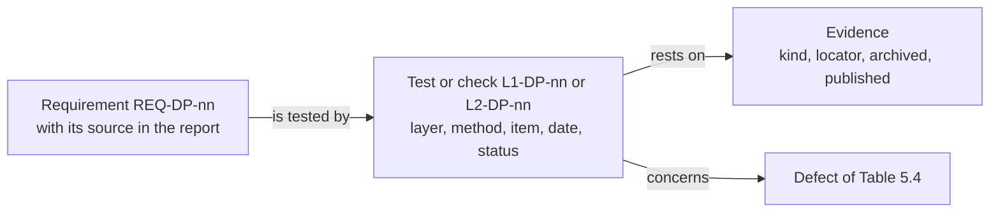

<!--
SPDX-FileCopyrightText: 2026 Mert Torun
SPDX-License-Identifier: CC-BY-4.0
-->

# Ensuring Functional Equivalence in Retrofitted Anti-Skid Systems for European Public Transportation: A Hybrid Two-Layer Verification Methodology

Companion repository of the paper by Mert Torun, a Working Paper in the series Kölner Beiträge zur technischen Informatik, 2/2026, TH Köln, and of the research report from which the paper derives, submitted in 2025 and revised in 2026. Version of record of the paper: <https://doi.org/10.57684/COS-1494>

[](https://doi.org/10.57684/COS-1494) [](LICENSES/CC-BY-NC-ND-4.0.txt) [](LICENSES/CC-BY-4.0.txt) [](LICENSE) [](https://www.repostatus.org/#inactive)

> [!IMPORTANT]
> [`publication/2026_02_Retrofitted_Anti-Skid_System.pdf`](publication/2026_02_Retrofitted_Anti-Skid_System.pdf) is the deposited paper, byte for byte (1,565,058 bytes, SHA-256 `bcf68b4b845c68ab48b43c1d91c855af7f8aac18f7a7a0846a43210ca66a3ebf`). [`paper/`](paper/) holds the author's corrected manuscript, not the source of that file: where its text differs from the deposited text, the difference is a correction that [`ERRATA.md`](ERRATA.md) lists. [`report/`](report/) holds the research report in a revised edition of October 2026, which has not been re-assessed and awaits its deposit.

## Works in this repository

| Work | Status | Identifier | In this repository | Licence |
| --- | --- | --- | --- | --- |
| Paper: "Ensuring Functional Equivalence in Retrofitted Anti-Skid Systems for European Public Transportation: A Hybrid Two-Layer Verification Methodology" | Working Paper in the series Kölner Beiträge zur technischen Informatik, 2/2026, published on 2026-09-22 on Cologne Open Science; presented at the VIMS-Workshop 2026, TH Köln, on 2026-05-22 | DOI [10.57684/COS-1494](https://doi.org/10.57684/COS-1494) | [`publication/`](publication/), the deposited file; [`paper/`](paper/), the corrected manuscript; [`ERRATA.md`](ERRATA.md) | CC BY-NC-ND 4.0 |
| Research report: "Ensuring Functional Equivalence and Compliance with Functional Safety Standards in Retrofitted Anti-Skid Systems for European Public Transportation: A Methodological Approach to Testing, Certification, and Risk Mitigation for Modernised Safety-Critical Electronics" | Submitted in August 2025; revised edition of October 2026, not re-assessed, awaiting its deposit | a DOI after its deposit | [`report/`](report/), the LaTeX sources | CC BY 4.0; material credited to others excepted |
| Slides of the talk on the paper at the VIMS-Workshop 2026 | The sources of July 2026, revised in October 2026; the deck as presented is not archived | none | [`slides/`](slides/) | CC BY 4.0; material of third parties excepted; the research question and the drawing of the V-model taken from the paper keep its licence, CC BY-NC-ND 4.0 |
| Traceability data of the diagnostic path | Reconstructed in 2026 from Chapters 3 and 5 of the report | none | [`verification/`](verification/) | CC BY 4.0; the schema and the template MIT |

The paper derives from the version of the report submitted in August 2025, and where the two differ, the revised edition of the report is the corrected one (report, page ii). The revised edition in turn takes over parts of the paper: its description of the causes of B4 and B5 in the firmware of 2023 and of their fix follows Section V-E of the paper (report, Section 5.3), and Figures 3.1 and 4.1 are derived from Figs. 1 and 4 of the paper, as the comments in their sources in `report/fig/` state. The two works share figures, tables, a listing, and single sentences and captions; [`report/README.md`](report/README.md#overlap-with-the-paper) lists them. Passages of the report that also appear in the paper remain under the paper's licence, CC BY-NC-ND 4.0.

## Abstract

### Paper

<!--
SPDX-SnippetBegin
SPDX-SnippetCopyrightText: 2026 Mert Torun
SPDX-License-Identifier: CC-BY-NC-ND-4.0
SPDX-SnippetComment: The abstract and the index terms of the paper, quoted from page 3 of the deposited file.
-->

Modernising ageing safety-critical electronics in public transportation is often more cost-effective and environmentally sustainable than complete system replacement—provided functional equivalence with the original design can be rigorously demonstrated under contemporary safety standards. This paper presents a case study of retrofitting a legacy anti-skid test-diagnosis module used in European urban rail. An obsolete Intel MCS-48 microcontroller was replaced with a flash-based Field-Programmable Gate Array (FPGA; Actel A3P1000) emulating the original processor and I/O logic, complemented by a galvanically isolated STM32 microcontroller subsystem for enhanced diagnostics. To verify the retrofit, a two-layer verification methodology was developed, derived from the V-model as defined in IEC 61508 and IEEE 1012: (1) deterministic component and interface testing via VHDL simulation and hardware timing measurements, and (2) scenario-based system-level testing using a dedicated hardware fixture with YAML-defined test cases. Through convergence of three independent evidence lines—simulation, oscilloscope measurement, and integrated scenario testing—functional equivalence of the safety-critical core was demonstrated for all documented fault codes, self-test sequences, and user interactions. Results were mapped to IEC 61508, EN 50129, EN 50716, and IEEE 1012. The methodology is assessed for transferability to other safety-critical retrofit contexts.

Index Terms, as printed on p. 3: Anti-Skid Protection, FPGA Emulation, Functional Equivalence, Functional Safety, IEC 61508, Retrofit Verification, Safety-Critical Systems, V-Model, Verification and Validation.

<!-- SPDX-SnippetEnd -->

Corrections to the deposited paper are listed in ERRATA.md.

<!--
SPDX-SnippetBegin
SPDX-SnippetCopyrightText: 2026 Mert Torun
SPDX-License-Identifier: CC-BY-NC-ND-4.0
SPDX-SnippetComment: Translations of the abstract of the paper, licensed like the paper.
-->

<details>
<summary><span lang="de">Deutsch: Zusammenfassung</span></summary>

<div lang="de">

Die Modernisierung alternder sicherheitskritischer Elektronik im öffentlichen Verkehr ist oft kosteneffizienter und ökologisch nachhaltiger als ein vollständiger Austausch des Systems, vorausgesetzt, die funktionale Gleichwertigkeit mit dem ursprünglichen Entwurf lässt sich nach den heute geltenden Sicherheitsnormen stringent nachweisen. Dieser Beitrag stellt eine Fallstudie zur Nachrüstung eines bestehenden Test- und Diagnosemoduls eines Gleitschutzsystems vor, das im europäischen städtischen Schienenverkehr eingesetzt wird. Ein abgekündigter Intel-MCS-48-Mikrocontroller wurde durch ein Flash-basiertes Field-Programmable Gate Array (FPGA; Actel A3P1000) ersetzt, das den ursprünglichen Prozessor und die I/O-Logik emuliert, ergänzt um ein galvanisch getrenntes STM32-Mikrocontroller-Subsystem zur erweiterten Diagnose. Zur Verifikation der Nachrüstung wurde eine zweistufige Verifikationsmethodik entwickelt, die aus dem in IEC 61508 und IEEE 1012 definierten V-Modell abgeleitet ist: (1) deterministische Komponenten- und Schnittstellentests mittels VHDL-Simulation und Hardware-Zeitmessungen sowie (2) szenariobasierte Tests auf Systemebene an einem eigens dafür ausgelegten Hardware-Prüfstand mit in YAML definierten Testfällen. Durch das Zusammenführen dreier unabhängiger Nachweislinien, nämlich der Simulation, der Oszilloskop-Messung und der integrierten Szenariotests, wurde die funktionale Gleichwertigkeit des sicherheitskritischen Kerns für alle dokumentierten Fehlercodes, Selbsttestabläufe und Bedienhandlungen nachgewiesen. Die Ergebnisse wurden auf IEC 61508, EN 50129, EN 50716 und IEEE 1012 abgebildet. Die Übertragbarkeit der Methodik auf andere Nachrüstungen im sicherheitskritischen Umfeld wird bewertet.

</div>

_Translation of the English abstract, published by the author in this repository. It is not part of the publication, which appears in English only, and was not reviewed by the series editors; the English text is authoritative. Licensed CC BY-NC-ND 4.0, like the paper._

</details>

<details>
<summary><span lang="fr">Français: Résumé</span></summary>

<div lang="fr">

La modernisation d’une électronique vieillissante et critique pour la sécurité dans les transports publics est souvent plus rentable et plus durable sur le plan environnemental que le remplacement complet du système, à condition que l’équivalence fonctionnelle avec la conception d’origine puisse être démontrée rigoureusement au regard des normes de sécurité actuelles. Cet article présente une étude de cas portant sur la mise à niveau d’un module existant de test et de diagnostic d’un système anti-enrayeur, utilisé dans le transport ferroviaire urbain européen. Un microcontrôleur Intel MCS-48 obsolète a été remplacé par un circuit intégré prédiffusé programmable (FPGA ; Actel A3P1000) à mémoire flash, qui émule le processeur et la logique d’entrées-sorties d’origine, complété par un sous-système à microcontrôleur STM32 isolé galvaniquement pour un diagnostic étendu. Pour vérifier cette mise à niveau, une méthodologie de vérification en deux couches a été développée, dérivée du modèle en V tel que le définissent les normes IEC 61508 et IEEE 1012 : (1) des essais déterministes des composants et des interfaces par simulation VHDL et par mesures temporelles sur le matériel, et (2) des essais au niveau système fondés sur des scénarios, au moyen d’un banc d’essai matériel dédié et de cas de test définis en YAML. Grâce à la convergence de trois lignes de preuve indépendantes, à savoir la simulation, la mesure à l’oscilloscope et les essais intégrés fondés sur des scénarios, l’équivalence fonctionnelle du cœur critique pour la sécurité a été démontrée pour l’ensemble des codes de défaut, des séquences d’autotest et des interactions utilisateur figurant dans la documentation. Les résultats ont été mis en correspondance avec les normes IEC 61508, EN 50129, EN 50716 et IEEE 1012. La méthodologie est évaluée quant à sa transposabilité à d’autres contextes de mise à niveau critiques pour la sécurité.

</div>

_Translation of the English abstract, published by the author in this repository. It is not part of the publication, which appears in English only, and was not reviewed by the series editors; the English text is authoritative. Licensed CC BY-NC-ND 4.0, like the paper._

</details>

<details>
<summary><span lang="tr">Türkçe: Özet</span></summary>

<div lang="tr">

Toplu taşımacılıkta güvenlik açısından kritik, yaşlanan elektronik donanımın modernizasyonu, sistemin tamamen değiştirilmesine kıyasla çoğu zaman daha uygun maliyetli ve çevresel açıdan daha sürdürülebilirdir; ancak bu, özgün tasarımla işlevsel eşdeğerliğin güncel güvenlik standartları çerçevesinde titizlikle gösterilebilmesine bağlıdır. Bu makale, Avrupa kentsel raylı ulaşımında kullanılan bir tekerlek kayma koruma sistemine ait eski bir test ve tanılama modülünün yenilenmesine (retrofit) ilişkin bir vaka çalışması sunmaktadır. Üretimden kalkmış bir Intel MCS-48 mikrodenetleyicisi, özgün işlemciyi ve giriş/çıkış (I/O) mantığını emüle eden flash tabanlı bir Sahada Programlanabilir Kapı Dizisi (FPGA; Actel A3P1000) ile değiştirilmiş; bu yapı, gelişmiş tanılama için galvanik olarak yalıtılmış bir STM32 mikrodenetleyici alt sistemiyle tamamlanmıştır. Yenilemeyi doğrulamak amacıyla, IEC 61508 ve IEEE 1012'de tanımlanan V modelinden türetilmiş iki katmanlı bir doğrulama metodolojisi geliştirilmiştir: (1) VHDL simülasyonu ve donanım zamanlama ölçümleriyle deterministik bileşen ve arayüz testleri ve (2) bu amaca özel bir donanım test düzeneğiyle ve YAML ile tanımlanmış test senaryolarıyla senaryo tabanlı sistem düzeyi testleri. Birbirinden bağımsız üç kanıt kaynağının, yani simülasyonun, osiloskop ölçümünün ve entegre senaryo testlerinin bir araya getirilmesiyle, güvenlik açısından kritik çekirdeğin işlevsel eşdeğerliği belgelenmiş tüm arıza kodları, öz test dizileri ve kullanıcı etkileşimleri için gösterilmiştir. Sonuçlar IEC 61508, EN 50129, EN 50716 ve IEEE 1012 ile eşleştirilmiştir. Metodolojinin güvenlik açısından kritik diğer yenileme bağlamlarına aktarılabilirliği değerlendirilmektedir.

</div>

_Translation of the English abstract, published by the author in this repository. It is not part of the publication, which appears in English only, and was not reviewed by the series editors; the English text is authoritative. Licensed CC BY-NC-ND 4.0, like the paper._

</details>

<details>
<summary><span lang="es">Español: Resumen</span></summary>

<div lang="es">

La modernización de electrónica envejecida y crítica para la seguridad en el transporte público suele ser más rentable y más sostenible desde el punto de vista medioambiental que la sustitución completa del sistema, siempre que la equivalencia funcional con el diseño original pueda demostrarse con rigor conforme a las normas de seguridad actuales. Este artículo presenta un estudio de caso sobre la modernización de un módulo de prueba y diagnóstico heredado, perteneciente a un sistema antideslizamiento y utilizado en el ferrocarril urbano europeo. Un microcontrolador Intel MCS-48 obsoleto se sustituyó por una matriz de puertas programable en campo (FPGA; Actel A3P1000) basada en memoria flash, que emula el procesador y la lógica de entrada/salida (E/S) originales, complementada con un subsistema de microcontrolador STM32 aislado galvánicamente para un diagnóstico ampliado. Para verificar la modernización se desarrolló una metodología de verificación en dos niveles, derivada del modelo en V tal como lo definen las normas IEC 61508 e IEEE 1012: (1) pruebas deterministas de componentes e interfaces mediante simulación VHDL y mediciones de temporización en el hardware, y (2) pruebas a nivel de sistema basadas en escenarios, con un banco de pruebas de hardware específico y casos de prueba definidos en YAML. Mediante la convergencia de tres líneas de evidencia independientes, a saber, la simulación, la medición con osciloscopio y las pruebas integradas basadas en escenarios, se demostró la equivalencia funcional del núcleo crítico para la seguridad respecto de todos los códigos de fallo, secuencias de autoprueba e interacciones de usuario documentados. Los resultados se pusieron en correspondencia con las normas IEC 61508, EN 50129, EN 50716 e IEEE 1012. Se evalúa la transferibilidad de la metodología a otros contextos de modernización críticos para la seguridad.

</div>

_Translation of the English abstract, published by the author in this repository. It is not part of the publication, which appears in English only, and was not reviewed by the series editors; the English text is authoritative. Licensed CC BY-NC-ND 4.0, like the paper._

</details>

<!-- SPDX-SnippetEnd -->

### Report

The report's title and subtitle, as its title page prints them: _Ensuring Functional Equivalence and Compliance with Functional Safety Standards in Retrofitted Anti-Skid Systems for European Public Transportation: A Methodological Approach to Testing, Certification, and Risk Mitigation for Modernised Safety-Critical Electronics_.

Modernising ageing safety-critical electronics is often more cost-effective and environmentally sustainable than complete replacement, provided that functional equivalence with the original system can be demonstrated and the modernised system re-certified against contemporary, more stringent standards. This case study, which continues prior work, addresses this challenge through the example of a legacy anti-skid test-diagnosis module used in European urban rail.

A legacy 8-bit controller board based on the Intel MCS-48 was retrofitted with a flash-based Actel A3P1000 field-programmable gate array (FPGA) emulating the original central processing unit (CPU) and input/output (I/O) logic, complemented by a galvanically isolated 32-bit Arm® microcontroller (µC), an STM32F401RET6, for enhanced data logging. A central aim was a methodological testing framework suitable for broader application in safety-critical system retrofits. Its core is a two-layer verification strategy derived from the V-model: (1) Component and Interface Tests: Deterministic hardware description language (HDL) simulation, JTAG checks and hardware timing measurements examine logical correctness, basic hardware integrity and interface timing (e.g., watchdog, frequency sweep). (2) System-Level Tests: Scenario-based testing on a dedicated test fixture [8] with YAML-defined test cases examines integrated behaviour (fault memory, self-tests, diagnostics). Simulation and integrated scenario testing indicate functional equivalence of the fault handling of the safety-critical core (fault detection, storage, display and read-out), but the only measurement against the original board shows a deviation of the frequency sweep, which in the emulation ends about 70 Hz lower (about 850 Hz against about 920 Hz) and runs faster than the original’s frequency change of about 180 ms; this open deviation needs a re-measurement of the original board or a check of its sweep circuit, and the evidence is not yet complete: the archived simulations and measurements date from 2023, before the rebuild; on the rebuilt unit, a follow-on team ran the fixture’s test suite without an archived log, and several scenarios, among them the self-test, are not documented for that unit. Six integration defects documented during the rebuild are classified by how they were found; they did not come to light in a planned run of the two-layer method, and no single method found all of them. The methodology was mapped to IEC 61508 Ed. 2, EN 50129:2018, EN 50155:2021, EN 50716:2023 and IEEE 1012:2024. Although comprehensive hardware-in-the-loop (HIL) test rigs were beyond this project’s scope, the approach follows HIL principles to facilitate future integration.

Refurbishing existing rolling-stock electronics can reduce costs and avoid the embodied emissions of manufacturing new components, and board-level retrofits share this rationale. A precedent is provided by an adaptive wheel-slide protection (WSP) function that is also intended for existing fleets and has been certified against the current standard, EN 15595; validation of the methodology across further retrofit cases remains future work.

Keywords, as printed on p. v: Anti-Skid Protection; Cost Efficiency; Deterministic Testing; Embedded Diagnostics; EN 50129; EN 50155; EN 50716; FPGA Emulation; Functional Equivalence; IEC 61508; IEEE 1012; Public Transport; Retrofit Validation; Safety Certification; Safety-Critical Systems; Scenario-Based Testing; Sustainability; Testing Methodology; V-Model; Verification and Validation.

In the abstracts, [8] is reference 8 of the report, the project report of 2023 on the test fixture.

<details>
<summary><span lang="de">Deutsch: Sicherstellung der funktionalen Gleichwertigkeit und der Einhaltung von Normen der funktionalen Sicherheit bei nachgerüsteten Gleitschutzsystemen im europäischen öffentlichen Verkehr: Ein methodischer Ansatz für Test, Zertifizierung und Risikominderung bei modernisierter sicherheitskritischer Elektronik</span></summary>

<div lang="de">

Die Modernisierung veralteter sicherheitskritischer Elektronik ist oft kostengünstiger und umweltfreundlicher als ein vollständiger Austausch, vorausgesetzt, die funktionale Gleichwertigkeit mit dem Originalsystem lässt sich nachweisen und das modernisierte System lässt sich nach aktuellen, strengeren Normen erneut zertifizieren. Diese Fallstudie, die an Vorarbeiten anschließt, behandelt diese Herausforderung am Beispiel eines bestehenden Test- und Diagnosemoduls eines Gleitschutzsystems aus dem europäischen städtischen Schienenverkehr.

Die bisherige 8-Bit-Controller-Platine auf Basis des Intel MCS-48 wurde mit einem Flash-basierten FPGA (Actel A3P1000) nachgerüstet, das die ursprüngliche CPU- und I/O-Logik emuliert, ergänzt um einen galvanisch getrennten 32-Bit-Arm®-µC (STM32F401RET6) für erweiterte Protokollierung. Ein zentrales Ziel war ein methodisches Test-Framework, das sich für eine breitere Anwendung bei der Nachrüstung sicherheitskritischer Systeme eignet. Kern dieser Methodik ist eine aus dem V-Modell abgeleitete zweistufige Verifikationsstrategie: (1) Komponenten- und Schnittstellentests: Deterministische HDL-Simulation, JTAG-Prüfungen und Hardware-Zeitmessungen überprüfen die logische Korrektheit, die grundlegende Integrität der Hardware und das Schnittstellen-Timing (z. B. Watchdog, Frequenzsweep). (2) Systemtests: Szenariobasierte Tests an einem speziellen Prüfstand [8] mit in YAML definierten Testfällen prüfen das integrierte Verhalten (Fehlerspeicher, Selbsttests, Diagnose). Simulation und integrierte Szenariotests sprechen für die funktionale Gleichwertigkeit der Fehlerbehandlung des sicherheitskritischen Kerns (Fehlererkennung, -speicherung, -anzeige und -auslesung), doch zeigt die einzige Vergleichsmessung mit der Originalplatine eine Abweichung des Frequenzsweeps, der in der Emulation etwa 70 Hz tiefer endet (etwa 850 Hz gegenüber etwa 920 Hz) und schneller verläuft als die etwa 180 ms dauernde Frequenzänderung des Originals; diese offene Abweichung erfordert eine erneute Messung der Originalplatine oder eine Prüfung ihrer Sweep-Schaltung, und der Nachweis ist noch unvollständig: Die archivierten Simulationen und Messungen stammen aus dem Jahr 2023 und damit aus der Zeit vor dem Nachbau; am nachgebauten Gerät führte ein Nachfolgeteam die Testsuite des Prüfstands ohne archiviertes Protokoll aus, und mehrere Szenarien, darunter der Selbsttest, sind für dieses Gerät nicht dokumentiert. Sechs beim Nachbau dokumentierte Integrationsfehler werden danach eingeordnet, wie sie gefunden wurden; sie traten nicht in einem geplanten Durchlauf der zweistufigen Methode zutage, und keine einzelne Methode fand alle. Die Methodik wurde auf IEC 61508 Ed. 2, EN 50129:2018, EN 50155:2021, EN 50716:2023 sowie IEEE 1012:2024 abgebildet. Vollständige HIL-Teststände lagen außerhalb des Projektumfangs; das Vorgehen folgt jedoch HIL-Grundsätzen und erleichtert so eine spätere Integration.

Die Aufarbeitung vorhandener Fahrzeugelektronik kann Kosten senken und die grauen Emissionen einer Neufertigung vermeiden; für Nachrüstungen auf Platinenebene gilt dieselbe Begründung. Einen Präzedenzfall bietet eine adaptive Gleitschutzfunktion, die auch für bestehende Flotten vorgesehen ist und nach der geltenden Norm EN 15595 zertifiziert wurde; die Validierung der Methodik an weiteren Nachrüstfällen bleibt zukünftigen Arbeiten vorbehalten.

</div>

_As printed in the report (pp. vi and vii). The English abstract is authoritative._

</details>

<details>
<summary><span lang="fr">Français: Garantir l’équivalence fonctionnelle et la conformité aux normes de sécurité fonctionnelle dans les systèmes anti-enrayeur mis à niveau destinés aux transports publics européens: Une approche méthodologique des essais, de la certification et de l’atténuation des risques pour une électronique modernisée et critique pour la sécurité</span></summary>

<div lang="fr">

La modernisation d’une électronique vieillissante et critique pour la sécurité est souvent plus rentable et plus durable sur le plan environnemental que son remplacement complet, à condition que l’équivalence fonctionnelle avec le système d’origine puisse être démontrée et le système modernisé certifié à nouveau selon des normes actuelles, plus exigeantes. Cette étude de cas, qui s’inscrit dans la continuité de travaux antérieurs, aborde ce défi à travers l’exemple d’un module existant de test et de diagnostic d’un système anti-enrayeur, utilisé dans le transport ferroviaire urbain européen.

Une carte contrôleur 8 bits existante, basée sur l’Intel MCS-48, a été mise à niveau au moyen d’un circuit intégré prédiffusé programmable (FPGA) Actel A3P1000 à mémoire flash, qui émule l’unité centrale de traitement (CPU) et la logique d’entrées-sorties (E/S) d’origine, complété par un microcontrôleur (µC) Arm® 32 bits isolé galvaniquement, un STM32F401RET6, pour une journalisation étendue des données. Un objectif central était l’élaboration d’un cadre méthodologique de test se prêtant à une application plus large dans la mise à niveau de systèmes critiques pour la sécurité. Au cœur de ce cadre se trouve une stratégie de vérification en deux couches, dérivée du modèle en V : (1) Essais des composants et des interfaces : la simulation déterministe en langage de description de matériel (HDL), les contrôles JTAG et les mesures temporelles sur le matériel examinent l’exactitude logique, l’intégrité de base du matériel et le comportement temporel des interfaces (par exemple chien de garde, balayage en fréquence). (2) Essais au niveau système : des essais fondés sur des scénarios, menés sur un banc d’essai dédié [8] avec des cas de test définis en YAML, examinent le comportement intégré (mémoire des défauts, autotests, diagnostic). La simulation et les essais intégrés fondés sur des scénarios indiquent l’équivalence fonctionnelle du traitement des défauts par le cœur critique pour la sécurité (détection, mémorisation, affichage et lecture des défauts), mais la seule mesure comparative avec la carte d’origine montre un écart du balayage en fréquence, qui, dans l’émulation, se termine environ 70 Hz plus bas (environ 850 Hz contre environ 920 Hz) et se déroule plus vite que la variation de fréquence de l’original, d’environ 180 ms ; cet écart, qui reste ouvert, nécessite une nouvelle mesure de la carte d’origine ou une vérification de son circuit de balayage, et les éléments de preuve ne sont pas encore complets : les simulations et mesures archivées datent de 2023 et sont donc antérieures à la reconstruction ; sur l’appareil reconstruit, une équipe ayant poursuivi les travaux a exécuté la suite de tests du banc d’essai sans qu’un journal ait été archivé, et plusieurs scénarios, dont l’autotest, ne sont pas documentés pour cet appareil. Six défauts d’intégration documentés au cours de la reconstruction sont classés selon la manière dont ils ont été découverts ; ils n’ont pas été mis en évidence lors d’une application planifiée de la méthode en deux couches, et aucune méthode ne les a tous trouvés à elle seule. La méthodologie a été mise en correspondance avec les normes IEC 61508 Ed. 2, EN 50129:2018, EN 50155:2021, EN 50716:2023 et IEEE 1012:2024. Bien que des installations d’essai complètes de type matériel dans la boucle (HIL) aient dépassé le cadre de ce projet, la démarche suit les principes HIL afin de faciliter une intégration future.

La remise à neuf de l’électronique existante du matériel roulant peut réduire les coûts et éviter les émissions grises liées à la fabrication de nouveaux composants, et les mises à niveau à l’échelle de la carte électronique relèvent de la même logique. Une fonction anti-enrayeur (WSP) adaptative, destinée également aux flottes existantes et certifiée selon la norme EN 15595 en vigueur, constitue un précédent ; la validation de la méthodologie sur d’autres cas de mise à niveau reste à mener dans des travaux futurs.

</div>

_As printed in the report (pp. viii and ix). The English abstract is authoritative._

</details>

<details>
<summary><span lang="tr">Türkçe: Avrupa Toplu Taşımacılığına Yönelik Yenilenmiş Tekerlek Kayma Koruma Sistemlerinde İşlevsel Eşdeğerliğin ve Fonksiyonel Güvenlik Standartlarına Uygunluğun Sağlanması: Modernize Edilmiş, Güvenlik Açısından Kritik Elektronikte Test, Sertifikasyon ve Risk Azaltmaya Yönelik Metodolojik Bir Yaklaşım</span></summary>

<div lang="tr">

Güvenlik açısından kritik, yaşlanan elektronik donanımın modernizasyonu, tamamen değiştirilmesine kıyasla çoğu zaman daha uygun maliyetli ve çevresel açıdan daha sürdürülebilirdir; ancak bu, özgün sistemle işlevsel eşdeğerliğin gösterilebilmesine ve modernize edilmiş sistemin güncel, daha sıkı standartlara göre yeniden sertifikalandırılabilmesine bağlıdır. Önceki araştırmaları sürdüren bu vaka çalışması, söz konusu zorluğu Avrupa kentsel raylı ulaşımında kullanılan, bir tekerlek kayma koruma sistemine ait eski bir test ve tanılama modülü örneği üzerinden ele almaktadır.

Yenileme (retrofit) kapsamında, Intel MCS-48 tabanlı, 8 bitlik eski bir denetleyici kartı, özgün merkezî işlem birimini (CPU) ve giriş/çıkış (I/O) mantığını emüle eden, flash tabanlı bir Actel A3P1000 Sahada Programlanabilir Kapı Dizisi (FPGA) ile donatılmış; bu yapı, gelişmiş veri kaydı için galvanik olarak yalıtılmış, 32 bitlik bir Arm® mikrodenetleyici (µC) olan STM32F401RET6 ile tamamlanmıştır. Merkezî bir hedef, güvenlik açısından kritik sistemlerin yenilenmesinde daha geniş çapta uygulanmaya elverişli, metodolojik bir test çerçevesi oluşturmaktı. Bu çerçevenin özü, V modelinden türetilmiş iki katmanlı bir doğrulama stratejisidir: (1) Bileşen ve Arayüz Testleri: Deterministik donanım tanımlama dili (HDL) simülasyonu, JTAG kontrolleri ve donanım zamanlama ölçümleri, mantıksal doğruluğu, donanımın temel bütünlüğünü ve arayüz zamanlamasını (örneğin watchdog zamanlayıcısı, frekans taraması) incelemektedir. (2) Sistem Düzeyi Testleri: Bu amaca özel bir test düzeneğinde [8], YAML ile tanımlanmış test senaryolarıyla yürütülen senaryo tabanlı testler, entegre davranışı (arıza belleği, öz testler, tanılama) incelemektedir. Simülasyon ve entegre senaryo testleri, güvenlik açısından kritik çekirdeğin arıza işlemedeki (arızanın algılanması, kaydedilmesi, gösterilmesi ve okunması) işlevsel eşdeğerliğine işaret etmektedir; ancak özgün kartla karşılaştırma yapılan tek ölçüm, emülasyonda yaklaşık 70 Hz daha düşük bir değerde sona eren (emülasyonda yaklaşık 850 Hz, özgün kartta yaklaşık 920 Hz) ve özgün kartın yaklaşık 180 ms süren frekans değişiminden daha hızlı ilerleyen frekans taramasında bir sapma göstermektedir; açık olan bu sapma, özgün kartın yeniden ölçülmesini ya da tarama devresinin kontrol edilmesini gerektirmektedir ve kanıtlar henüz eksiksiz değildir: Arşivlenmiş simülasyonlar ve ölçümler 2023 yılına, yani yeniden yapım öncesine aittir; yeniden yapılan cihazda ise çalışmaları devralan bir ekip, test düzeneğinin test paketini arşivlenmiş bir kayıt olmaksızın yürütmüştür ve aralarında öz testin de bulunduğu birkaç senaryo bu cihaz için belgelenmemiştir. Yeniden yapım sırasında belgelenen altı entegrasyon hatası, nasıl bulunduklarına göre sınıflandırılmaktadır; hatalar, iki katmanlı yöntemin planlı bir uygulamasında gün yüzüne çıkmamıştır ve hiçbir yöntem bu hataların tümünü tek başına bulamamıştır. Metodoloji IEC 61508 Ed. 2, EN 50129:2018, EN 50155:2021, EN 50716:2023 ve IEEE 1012:2024 ile eşleştirilmiştir. Döngüde donanım (HIL) testine yönelik eksiksiz sistemler bu projenin kapsamı dışında kalmış olsa da yaklaşım, ileride yapılacak bir entegrasyonu kolaylaştırmak için HIL ilkelerini izlemektedir.

Mevcut raylı araç elektroniğinin elden geçirilmesi maliyetleri düşürebilir ve yeni bileşenlerin üretiminden kaynaklanan gömülü emisyonların önüne geçebilir; kart düzeyindeki yenilemeler de aynı gerekçeye dayanır. Var olan filolarda da kullanılması öngörülen ve yürürlükteki EN 15595 standardına göre sertifikalandırılmış uyarlamalı bir tekerlek kayma koruma (WSP) işlevi bir emsal oluşturmaktadır; metodolojinin başka yenileme vakalarında geçerliliğinin sınanması ise gelecekteki çalışmalara bırakılmıştır.

</div>

_As printed in the report (pp. x and xi). The English abstract is authoritative._

</details>

<details>
<summary><span lang="es">Español: Garantizar la equivalencia funcional y el cumplimiento de las normas de seguridad funcional en sistemas antideslizamiento modernizados para el transporte público europeo: Un enfoque metodológico para las pruebas, la certificación y la mitigación de riesgos en electrónica modernizada y crítica para la seguridad</span></summary>

<div lang="es">

La modernización de electrónica envejecida y crítica para la seguridad suele ser más rentable y más sostenible desde el punto de vista medioambiental que su sustitución completa, siempre que la equivalencia funcional con el sistema original pueda demostrarse y el sistema modernizado pueda volver a certificarse conforme a normas actuales y más exigentes. Este estudio de caso, que da continuidad a trabajos previos, aborda este reto tomando como ejemplo un módulo de prueba y diagnóstico heredado, perteneciente a un sistema antideslizamiento y utilizado en el ferrocarril urbano europeo.

Una placa controladora de 8 bits heredada, construida en torno al Intel MCS-48, se modernizó con una matriz de puertas programable en campo (FPGA) Actel A3P1000 basada en memoria flash, que emula la unidad central de procesamiento (CPU) y la lógica de entrada/salida (E/S) originales, complementada con un microcontrolador (µC) Arm® de 32 bits aislado galvánicamente, un STM32F401RET6, para un registro de datos ampliado. Un objetivo central era desarrollar un marco metodológico de pruebas adecuado para una aplicación más amplia en la modernización de sistemas críticos para la seguridad. Su núcleo es una estrategia de verificación en dos niveles derivada del modelo en V: (1) Pruebas de componentes e interfaces: la simulación determinista en lenguaje de descripción de hardware (HDL), las comprobaciones JTAG y las mediciones de temporización en el hardware examinan la corrección lógica, la integridad básica del hardware y la temporización de las interfaces (por ejemplo, perro guardián y barrido de frecuencia). (2) Pruebas a nivel de sistema: las pruebas basadas en escenarios, realizadas en un banco de pruebas específico [8] con casos de prueba definidos en YAML, examinan el comportamiento integrado (memoria de fallos, autopruebas, diagnóstico). La simulación y las pruebas integradas basadas en escenarios indican la equivalencia funcional del tratamiento de fallos del núcleo crítico para la seguridad (detección, almacenamiento, visualización y lectura de fallos), pero la única medición comparativa con la placa original muestra una desviación del barrido de frecuencia, que en la emulación termina unos 70 Hz más abajo (unos 850 Hz frente a unos 920 Hz) y transcurre más rápido que la variación de frecuencia del original, de unos 180 ms; esta desviación, que sigue abierta, requiere una nueva medición de la placa original o una comprobación de su circuito de barrido, y la evidencia aún no está completa: las simulaciones y mediciones archivadas datan de 2023 y son, por tanto, anteriores a la reconstrucción; en la unidad reconstruida, un equipo que continuó los trabajos ejecutó el conjunto de pruebas del banco sin registro archivado, y varios escenarios, entre ellos la autoprueba, no están documentados para esa unidad. Seis defectos de integración documentados durante la reconstrucción se clasifican según cómo se encontraron; no salieron a la luz en una aplicación planificada del método en dos niveles, y ningún método por sí solo los encontró todos. La metodología se puso en correspondencia con las normas IEC 61508 Ed. 2, EN 50129:2018, EN 50155:2021, EN 50716:2023 e IEEE 1012:2024. Aunque las instalaciones completas de pruebas de hardware en el bucle (HIL) quedaban fuera del alcance de este proyecto, el enfoque sigue los principios HIL para facilitar una integración futura.

El reacondicionamiento de la electrónica existente del material rodante puede reducir costes y evitar las emisiones incorporadas que conlleva la fabricación de componentes nuevos, y las modernizaciones a nivel de placa obedecen a la misma lógica. Una función adaptativa de protección antideslizamiento de las ruedas (WSP), destinada también a flotas existentes y certificada conforme a la norma vigente EN 15595, constituye un precedente; la validación de la metodología en otros casos de modernización queda como trabajo futuro.

</div>

_As printed in the report (pp. xii and xiii). The English abstract is authoritative._

</details>

## Publication

| Field | Paper | Report |
| --- | --- | --- |
| Type | Working Paper, the document type of the catalogue record, in the series Kölner Beiträge zur technischen Informatik (ISSN 2193-570X), volume 2/2026 | Research report, as the title page names it |
| Institution | TH Köln (Technische Hochschule Köln) | TH Köln (Technische Hochschule Köln) |
| Faculty | Faculty of Information, Media and Electrical Engineering (F07) | Faculty of Information, Media and Electrical Engineering (F07) |
| Institute | Institute of Computer and Communication Technology, as the catalogue record names it; the paper names no institute | The report names no institute |
| Programme | none | M.Sc. Computer Science & Engineering (Technische Informatik), as the title page prints it |
| Submitted | 2026-06-28: the version the author sent to the editors of the series, which the series printed | August 2025; revised edition of October 2026 |
| Examined | not applicable | The version of August 2025 was assessed; the revised edition has not been re-assessed |
| Published | 2026-09-22, open access on Cologne Open Science, a publication server of TH Köln, by the Bibliothek der Technischen Hochschule Köln, the publisher the catalogue record names; presented on 2026-05-22 at the VIMS-Workshop 2026 of the research focus Vernetzte intelligente Infrastrukturen und mobile Systeme, TH Köln, as page 2 of the deposited file records | Not yet; the revised edition awaits its deposit on ePublications, a publication server of TH Köln |
| DOI | <https://doi.org/10.57684/COS-1494> | after its deposit |
| URN | [urn:nbn:de:hbz:832-cos4-14942](https://nbn-resolving.org/urn:nbn:de:hbz:832-cos4-14942) | after its deposit |
| Licence | CC BY-NC-ND 4.0, as the catalogue record states; the imprint on page 2 names the licence terms without a version ([`ERRATA.md`](ERRATA.md#2-properties-of-the-record-and-the-deposited-file), section 2). The measurement captures of Figs. 3 and 5 and Listing 1, which is adapted from the test fixture report, are excepted, see [`NOTICE`](NOTICE) | CC BY 4.0, as the title page states; material credited to others, among it the mark of TH Köln, is excepted, and passages that also appear in the paper remain under its licence |
| Language | English | English; title and abstract are printed in five languages, English, German, French, Turkish and Spanish, and the English version is authoritative |
| Pages | 10: the series cover (p. 1), the imprint (p. 2) and the paper (pp. 3 to 10) | 82; a build has 102 pages, 20 of them front matter |
| Classification | DDC 004 (Data processing & computer science) and 621.3 (Electrical engineering, electronics); ACM CCS 1998: B.6.3 (Design Aids), subentry "Verification", B.8.1 (Reliability, Testing, and Fault-Tolerance) and C.3 (Special-Purpose and Application-Based Systems); as the catalogue record holds them on 2026-10-04 | after its deposit |

## Version of record

[`publication/2026_02_Retrofitted_Anti-Skid_System.pdf`](publication/2026_02_Retrofitted_Anti-Skid_System.pdf) is byte-identical with the file the catalogue record serves under the DOI above: 1,565,058 bytes, SHA-256 `bcf68b4b845c68ab48b43c1d91c855af7f8aac18f7a7a0846a43210ca66a3ebf`. It is the editors' build of the version the author sent on 2026-06-28, with the series cover, the imprint and the running header and footer of the series added. The tag `cos-1494` marks the state of this repository that holds it.

The LaTeX sources of the version of 2026-06-28 are not available to this repository; the earliest that are, of 2026-07-12, already differ from the deposited text. [`paper/`](paper/) therefore holds the author's corrected manuscript: its text is the text of pages 3 to 10 of the deposited file, except where it applies the corrections of six entries of [`ERRATA.md`](ERRATA.md), P-E003, P-E013, P-E015, P-E018, P-E031 and P-E034; [`paper/README.md`](paper/README.md) names each difference. A build of `paper/` is therefore not the version of record. The research report is not deposited yet; its record joins this folder after its deposit, under a tag of its own.

[`publication/README.md`](publication/README.md) states how the deposited file came about and gives the ways to verify it, with and without a GitHub account.

## The work in brief

### Who did what

The work that the paper and the report describe was done by several people; Section 1.4 of the report states who did what, from the sources it cites:

- **S. Ayoub** prepared an FPGA-based redesign of the system's comparator card in 2014, in which an emulated CPU runs the unchanged original program (report, Sections 1.1 and 2.1.1).
- **M. Leyer** reverse-engineered the test-diagnosis board in 2023, designed its FPGA emulation, whose 8048 core and port expanders come from an open-source project of OpenCores, designed the Rev 0.0 boards and the Rev 1.0 layouts, and tested the Rev 0.0 prototype. The oscilloscope captures in both works are his (report, Figures 5.1 and C.1).
- **A. Dolata, D. Ostermann and F. Schiffelers** developed the test fixture of Layer 2 in 2023, with its YAML test format and its PC application (report, Section 4.3).
- **A follow-on student project** in 2025 made the fixture usable, brought the rebuilt unit up on it, found and corrected B1 and B2, found B6 and worked around it, ran the fixture's suite, and documented B4 and the transmitter part of B5. The first four poorly soldered FPGA pins of B3 were re-soldered by the supervisor (report, Table 5.4).
- **The author** completed the Rev 1.0 design for manufacture in June 2024, replacing the end-of-life displays and splitting the design into one board file per board, continued the bill of materials, and wrote the report, its revised edition and the paper.

Who assembled the Rev 1.0 boards and who applied the fix of B4 and B5 is not recorded in the sources the report cites.

### The retrofit

The case is the test-diagnosis module of an anti-skid system that has been in service in European urban rail since the early 1990s; its controller belongs to the obsolete Intel MCS-48 family (report, Chapter 1). The rebuilt unit is the inherited Rev 0.0 Base Board with the Rev 1.0 Upper, LED and STM32 boards (report, Section 3.1):

- **Base Board:** an Actel A3P1000, a flash-based FPGA, emulates the original processor and its I/O logic. Its MCS-48 core is "the OpenCores t48 core, release rel_1_2, integrated without changes to the core" ([`ERRATA.md`](ERRATA.md#p-e018), P-E018).
- **Upper Board:** the four legacy buttons and the external watchdog with its reset circuit.
- **LED Board:** the two 7-segment displays that show the fault codes.
- **STM32 Diagnostics Board:** an STM32F401RET6 microcontroller, galvanically isolated from the core by optocouplers, which logs the diagnostic frames of the FPGA with timestamps to an SD card; a USB connector gives a PC access to the card (report, Section 3.3).

### Two layers of verification

The report proposes a verification structure of two layers and maps it to the verification side of the V-model (report, Chapter 4 and Section 5.4.1):

- **Layer 1, component and interface tests:** VHDL simulation of the FPGA design, JTAG and pin checks, and oscilloscope measurements of the watchdog and the frequency sweep.
- **Layer 2, system-level tests:** scenarios defined in YAML, which a host PC runs through the test fixture at the system connector of the unit, against the behaviour of the legacy module. The suite is designed to cover the fault memory cycles of the legacy diagnosis table, the self-test, the buttons, power cycles and the diagnostic SPI transmission (report, Section 4.3).

The structure is proposed, not validated (report, Section 1.4). No requirement list exists for the module; the legacy behaviour serves as the requirement (report, Section 5.4.1).

### The state of the evidence

Simulation and the fixture runs indicate equivalence of the fault handling, but the evidence does not demonstrate equivalence (report, Section 5.1.3 and Table 5.3):

- The archived simulations and measurements date from 2023 and concern the design and the Rev 0.0 prototype, before the rebuild. The archived simulation could not detect B1, because its model of the NVRAM ignores the byte-low enable.
- On the rebuilt unit, the follow-on project ran the fixture's full suite in 2025, which it reports as successful, and a selection of 19 test cases, for which the expected codes were observed on the displays; the fixture's camera could not read them, and no log was archived. The self-test, the Test and Tür/V buttons, power cycles, the watchdog, the sweep and the brown-out detection are not documented for that unit.
- The only measurement against the original board, the frequency sweep, points to a deviation, described below; it is open.
- Two hardware changes alter the behaviour of the module by design: the STORE and RECALL inputs of the system connector (08z, 08d) no longer act on the fault memory, and the added brown-out detection adds a reset. Whether either matters in the vehicle is open (report, Section 4.6 and Table 5.3).

The abstract of the paper states that functional equivalence of the safety-critical core "was demonstrated", and Section V-A that the convergence of three lines of evidence "provides robust assurance" of it. [`ERRATA.md`](ERRATA.md#p-e002), P-E002, corrects this: "was demonstrated" and "robust assurance" are not supported, and the evidence for the rebuilt unit is incomplete. The revised report states the evidence more narrowly than the replacement wording of P-E002: simulation and the fixture runs indicate equivalence of the fault handling, the frequency sweep, the only measurement against the original board, points to a deviation that is open, and two hardware changes alter the behaviour of the module by design (report, Sections 4.6, 5.1.1 and 5.1.3).

### Integration defects

Table 5.4 of the report classifies six defects documented during the rebuild; the paper counts five, and the sixth, B6, is new in the revised edition (report, page ii).

| ID | Class | Defect | Found by | Status |
| --- | --- | --- | --- | --- |
| B1 | Logical | NVRAM byte-low enable (`NVRAM_ble`) held high | Symptoms on the fixture (Layer 2), cause by debugging | Resolved |
| B2 | Test fixture | SWD pins of the fixture's STM32 assigned to general-purpose I/O | Failed debugger connection to the fixture | Reworked |
| B3 | Assembly | Four and then about 40 further FPGA pins poorly soldered | Commissioning: oscilloscope, inspection | Reworked |
| B4 | Firmware | SD-card logging froze with the follow-on firmware of 2025, cause not established, no fix of that firmware documented; frames overrun by the mount overhead of the firmware of 2023, to which the fix was applied | Freeze: operation of the STM32 Diagnostics Board (2025); overrun: analysis of the firmware of 2023 | Fix applied (firmware of 2023); diagnostic path not verified separately; freeze with the firmware of 2025: no fix documented |
| B5 | Interface | SPI frame truncated to 16 of 32 bits (firmware of 2023); third byte corrupted by the VHDL transmitter (2025); polarity and slave select at the receiver open | Transmitter: simulation testbench (Layer 1); receiver: not recorded | Receiver: fix applied; transmitter: change not documented; diagnostic path not verified separately |
| B6 | Schematic and layout | LED Board Rev 1.0 (2024): driver-to-display assignment reversed against the design of 2023 | Commissioning of the rebuilt unit | Worked around in the FPGA design (`atop.vhd`), not on the LED Board |

The diagnostic path comprises the SD-card logging and the complete SPI frames; both of its defects concern the non-safety-related diagnostic function. In early 2026 the author, the supervisor and members of the project team observed the rebuilt unit operating as a whole in the test setup; the diagnostic path itself was not verified separately, and no log or capture of that run was archived (report, Section 5.3). No single method found all six defects, and they did not come to light in a planned run of the two-layer method (report, Section 5.2).

### Two values worked through

The report reads two values from the captures of 2023 (report, Section 5.1.1):

- **Frequency sweep.** The emulation's sweep is designed for 849.9 Hz to 1549.6 Hz. Read from the captures, the falling-sweep readouts are 922.36 Hz for the original board and 850.31 Hz for the emulation (Table 5.1); the captures do not show what the readouts were measured over. Further captures of the original board, and the raw export of one of them, whose 459 periods lie between 916 Hz and 926 Hz, put its low end at about 920 Hz, about 70 Hz above the emulation's. The emulation's falling sweep reaches its end after about 102 ms, where the fixture report gives about 180 ms for the frequency changes of the original test card. Whether 920 Hz is the design value of the original circuit or a drift of this board is open.
- **Watchdog.** Leyer measured the period of the watchdog clock on the prototype as 180 ms. The counter it drives pulls the reset line low at the count of eight, so the reset follows seven to eight clock periods after the last service pulse, about 1.3 s to 1.4 s, lasts two periods and recurs every ten while service stays withheld. Read from the capture of 2023-08-15 (Figure C.1), the first reset follows about 1.2 s after the service stops, and resets of about 0.3 s recur about 1.6 s apart; these are approximate readings of a photograph of the screen, and they fit this decoding with a clock period somewhat below 180 ms. No observation of the watchdog on the rebuilt unit after the re-soldering is documented.

### German terms

The legacy system, its manual and most of the project reports are German, and the report keeps the German names of the buttons and boards as the manual and the design files give them. Their meaning, as the report gives it:

| Term | Meaning | In the report |
| --- | --- | --- |
| Gleitschutz | Anti-skid protection | German title and keywords, pp. vi and vii |
| STW (Störstellen-Abfrage) | Legacy button for the fault query: shows the stored fault information entry by entry | Section 3.1; list of abbreviations |
| Lösch | Legacy button that clears the stored fault information | Section 3.1 |
| Tür/V | Legacy button, V-SIGN on the front panel in the legacy manual: checks the speed-dependent signals at standstill | Section 3.1; list of abbreviations |
| Oberplatine | Upper Board | Section 3.1; Appendix A.4 |
| Unterplatine | Base Board | Section 3.1; Appendix A.3 |
| Vergleicherkarte | Comparator card of the legacy system | Figure 2.2 |

## Contents

| Path | Content | In the works | Licence |
| --- | --- | --- | --- |
| [`publication/`](publication/) | The deposited paper, its checksum and the ways to verify it | The paper, all 10 pages | CC BY-NC-ND 4.0; the captures of Figs. 3 and 5 and Listing 1 excepted |
| [`paper/`](paper/) | The author's corrected manuscript of the paper in LaTeX (IEEEtran), its 29 references and the captures of Figs. 3 and 5; its [`README.md`](paper/README.md) maps each difference from the deposited text to its erratum | The paper, pp. 3 to 10 | CC BY-NC-ND 4.0; the captures and Listing 1 excepted; IEEEtran LPPL 1.3c |
| [`report/`](report/) | The LaTeX sources of the research report, revised edition of October 2026; its [`README.md`](report/README.md) gives the edition note, the overlap with the paper and a map of the chapters | The whole report | CC BY 4.0; material credited to others excepted |
| [`slides/`](slides/) | The sources of the deck and the handout of the talk of 2026-05-22, revised after it; no slide PDF | Neither work | CC BY 4.0; material of third parties excepted; the two parts of `deck_frames.tex` taken from the paper, its research question and the drawing after its Fig. 2, keep its licence, CC BY-NC-ND 4.0 |
| [`verification/`](verification/) | The traceability data of the diagnostic path: the data in YAML, a CSV view, the schema, an empty template and a data dictionary | Report, Chapters 3 and 5 | CC BY 4.0 for the data; MIT for the schema and the template |
| [`tools/`](tools/) | Checks of the traceability data, of the citation metadata and of the links | Neither work | MIT |
| [`docs/social/`](docs/social/) | The social card of this repository and the script that renders it | Neither work | CC BY 4.0; the script MIT |
| [`ERRATA.md`](ERRATA.md) | The errors of the paper found so far, the properties of its record and of the deposited file, and moved web addresses | The paper | CC BY 4.0; its quotations of the paper CC BY-NC-ND 4.0 |
| [`CHANGELOG.md`](CHANGELOG.md), [`NOTICE`](NOTICE), [`CITATION.cff`](CITATION.cff), [`codemeta.json`](codemeta.json) | Changes, licences and credits, citation metadata | Neither work | CC BY 4.0; `CITATION.cff` CC BY-NC-ND 4.0, because it quotes the abstract of the paper |
| [`SECURITY.md`](SECURITY.md), [`CONTRIBUTING.md`](CONTRIBUTING.md) | How to report a matter privately, and how corrections are made | Neither work | CC BY 4.0 |
| [`Makefile`](Makefile), [`.github/`](.github/), [`.githooks/`](.githooks/) | Build and checks, workflows, the correction form, an opt-in secret scan for clones | Neither work | MIT |

### The paper and the report

| Section of the paper | Chapters of the report |
| --- | --- |
| I. Introduction | Chapter 1 |
| II. Background and Related Work | Chapter 2 |
| III. System Architecture | Chapter 3; Appendices A and B |
| IV. Verification Methodology | Chapter 4; Appendix D |
| V. Results and Discussion | Chapter 5; Appendix C |
| VI. Conclusion | Chapter 6 |
| none | Chapter 7, the safety checklist for retrofits |

## Traceability data

[`verification/`](verification/) holds the requirement-to-test data of the diagnostic path of the rebuilt unit, that is, the SPI link from the FPGA logger through the optocouplers to the STM32 Diagnostics Board and the logging of the frames: 8 requirements, 9 tests or checks, the status of each and the evidence each status rests on. The data were reconstructed in 2026 from Chapters 3 and 5 of the report: the requirements from the design description of Sections 3.2 and 3.3 and from Section 5.3, the statuses from what these sections and Tables 5.3 and 5.4 say of the tests; formal traceability matrices were not produced during the project (report, Section 4.5). They cover the diagnostic path only and are not a certification artefact. The same statement stands at the head of the YAML file and in every row of the CSV view, because both travel without this README.



The same structure as text: each requirement names its source in the report and has one or more tests or checks; each test has a layer, a method, the item tested, a date, a status and, where it concerns one, a defect of Table 5.4, and rests on at least one piece of evidence, which says what kind it is, where it stands, whether it is archived and whether it is published.

| Status | Tests | Meaning |
| --- | --- | --- |
| `PASS` | none | Tested and passed, with at least one archived piece of primary evidence: a log, a capture, a measurement or a test protocol |
| `OBSERVED` | L1-DP-03, L1-DP-09 | A result reported in a source, without an archived primary record |
| `FIX-APPLIED-NOT-VERIFIED` | L2-DP-04 (B5), L2-DP-06 (B4) | A fix was applied; the item was not verified separately afterwards |
| `OPEN` | L1-DP-02 (B5), L2-DP-05 (B4) | A defect was found, and no fix or change is documented |
| `NOT-DOCUMENTED` | L1-DP-01, L2-DP-07, L1-DP-08 | No test of the item is documented |

No test has the status `PASS`: no log, capture or measurement of the diagnostic path is archived. [`tools/check_traceability.py`](tools/check_traceability.py) holds the data to the schema [`traceability.schema.json`](verification/traceability.schema.json) (JSON Schema 2020-12) and to the rules of the format, refuses `PASS` without archived primary evidence, so that the text of the report alone never supports it, and requires the CSV view to equal its regeneration; its self-test applies each rule to a mutated copy that the rule has to refuse, among them B4 marked `PASS` on the report's text alone. With Python 3, PyYAML and jsonschema 4.0 or later:

```sh
make traceability    # check the data and the CSV view, then the self-test of the check
```

[`verification/README.md`](verification/README.md) is the data dictionary, with the status vocabulary and the words of the report each status stands for. [`template.yaml`](verification/template.yaml) is the format without data, for another retrofit; a filled-in copy is checked against the schema.

## What is public and what is not

The paper and the report rest on material that is not in this repository.

| Material | Here | Reason | Described in |
| --- | --- | --- | --- |
| The deposited paper | Yes, byte for byte, with the series cover and imprint | The version of record; it cannot change | [`publication/README.md`](publication/README.md) |
| The LaTeX sources of the paper as sent on 2026-06-28 | No | Not available; the earliest preserved sources are of 2026-07-12 | [`paper/README.md`](paper/README.md) |
| The corrected manuscript of the paper | Yes | Each difference from the deposited text is an erratum | [`paper/README.md`](paper/README.md) |
| The LaTeX sources of the report, revised edition | Yes | The work itself | [`report/README.md`](report/README.md) |
| The deck as presented on 2026-05-22 | No | Not archived; the sources here are a later revision | [`slides/README.md`](slides/README.md) |
| The VHDL sources of the FPGA design, of 2023 and of 2025 | No | Written by others in the project (report, Section 1.4), with the OpenCores t48 core under its own licence. This repository does not publish the design sources of third parties; it reproduces credited figures and excerpts ([`NOTICE`](NOTICE), section 2). Appendix D.2 of the report quotes twelve lines | Report, Sections 1.4 and 3.2 |
| The STM32 firmware | No | Written by others in the project: the firmware of 2023 is Leyer's link test program, that of 2025 the follow-on project's; the changed firmware of 2023 is not archived | Report, Sections 3.3 and 5.3 |
| The fixture's YAML test cases and PC application | No | The work of the fixture's authors; one test case is adapted in Appendix D.1 of the report and in Listing 1 of the paper | Report, Section 4.3 and Appendix D |
| The board design files | No | Leyer's design, completed for manufacture by the author in 2024; the schematic and the layouts are shown as renderings | Report, Appendix A |
| The project reports of the prior work, of 2014, 2023 and 2025 | No | Unpublished reports of third parties, which the report cites | Report, list of references |
| Logs and captures of the fixture runs of 2025 and of the operation in early 2026 | No | None was archived | Report, Table 5.3 |
| The oscilloscope captures of 2023 | Three, as figures | Leyer's captures, reproduced with credit and excepted from the licences of this repository | Report, Figures 5.1 and C.1; [`NOTICE`](NOTICE) |
| Markings of third-party origin on the boards | No | Masked in the photographs and left out of the layout renderings; they carry no technical content | Report, page ii; [`NOTICE`](NOTICE), section 3 |
| The manual of the legacy system | No | A document of its manufacturer; the report cites it and takes the legacy diagnosis codes from it | Report, Table 4.1 |

## Reproducing

### The documents

With TeX Live (pdfLaTeX, BibTeX, Biber, latexmk with makeglossaries, and ChkTeX), from the root of the repository:

```sh
make paper     # paper/.tmp.nosync/latex/paper.pdf, 8 pages
make report    # report/.tmp.nosync/latex/report.pdf, 102 pages, PDF/A-2b
make slides    # slides/.tmp.nosync/latex/presentation.pdf (15 frames) and handout.pdf
make check     # ChkTeX over the LaTeX sources
```

Each document is built with `SOURCE_DATE_EPOCH` set to the time of the last commit that changed its folder; the slides also count `paper/fig/`, whose captures the deck includes. Outside a clone, set `SOURCE_DATE_EPOCH` by hand. On 2026-10-06, each of the three, typeset twice from two copies of this repository in separate directories with TeX Live 2026 on macOS, gave the same bytes both times, and veraPDF 1.30.2 found the report conformant to PDF/A-2b. CI typesets each document twice in the container `ghcr.io/xu-cheng/texlive-full@sha256:11383430b9a3e48c0b79339f34d8092f942f897d91ab3749d4899d06731fea7f` and compares the bytes; its artifacts are builds, not the version of record.

A build of `paper/` is not the deposited file: it has neither the series cover, the imprint nor the running header and footer of the series, and its text differs by the corrections that [`paper/README.md`](paper/README.md) lists. A build of `report/` is the revised edition, not the version that was assessed in 2025.

What cannot be reproduced from this repository: the deposited file, which the editors built; and the measurements, the simulations and the fixture runs the works report, because the hardware, the fixture and their sources are not here (see [What is public and what is not](#what-is-public-and-what-is-not)).

### The data and the metadata

With Python 3, PyYAML and jsonschema 4.0 or later:

```sh
make traceability     # the traceability data, their CSV view and the self-test of the check
make metadata         # CITATION.cff, codemeta.json, the BibTeX entry below and SHA256SUMS agree
make verify-deposit   # the deposited file against publication/SHA256SUMS
```

### The checks CI runs

- [`build.yml`](.github/workflows/build.yml): the paper, the report and the slides, each typeset twice in the pinned container and compared byte for byte; ChkTeX.
- [`checks.yml`](.github/workflows/checks.yml): the deposited file against `SHA256SUMS`; every commit after the tag `cos-1494` that changes the manuscript in `paper/` names its erratum; `CITATION.cff` with cffconvert and against schema 1.2.0 through a plain YAML loader; `codemeta.json` expanded as JSON-LD; the agreement of `CITATION.cff`, `codemeta.json`, the BibTeX entry below and `SHA256SUMS`; REUSE; and the links to doi.org, nbn-resolving.org and the addresses of this repository, a check that runs on push and is not required.
- [`traceability.yml`](.github/workflows/traceability.yml): the traceability data and the self-test of their check.
- [`docs.yml`](.github/workflows/docs.yml) lints the Markdown files; [`secret-scan.yml`](.github/workflows/secret-scan.yml) scans the history with gitleaks.

## Limitations

- No certification or independent compliance assessment was performed; IEC 61508, IEEE 1012 and EN 50716 frame the method. The report maps its two layers to whole standards, not to individual clauses, and the mapping is not an assessment of compliance; no safety integrity level and no integrity level in the sense of IEEE 1012 were assigned, because no hazard analysis was made (report, Section 5.4 and Table 5.5).
- The evidence does not demonstrate functional equivalence (report, Section 5.1.3); the statement of the paper that it was demonstrated is not supported ([`ERRATA.md`](ERRATA.md#p-e002), P-E002). The deviation of the frequency sweep from the only measurement of the original board is open.
- The verification structure is proposed, not validated, and only this one case has been examined (report, Sections 1.4 and 5.1.3).
- No requirement list exists for the module, and no traceability matrix was produced during the project; the traceability data here are a reconstruction for the diagnostic path only (report, Section 4.5).
- B4 and B5 stand as Table 5.4 of the report gives them: the fixes of the firmware of 2023 were applied, the diagnostic path was not verified separately, and no log was archived; for the freeze with the firmware of 2025 no fix is documented, and a change of the VHDL transmitter is not documented.
- The deposited PDF is untagged, and its metadata declare PDF/A-1a, to which it does not conform ([`ERRATA.md`](ERRATA.md#2-properties-of-the-record-and-the-deposited-file), section 2). As the version of record it cannot be changed; the abstracts, the tables and the descriptions above are its accessible summary.

## Corrections

[`ERRATA.md`](ERRATA.md) lists the errors of the paper found so far under the identifiers P-E001 to P-E049, the properties of its catalogue record and of the deposited file, and the web addresses of the paper that have moved; errors of the report will be listed as R-E001 onwards once it is deposited. The deposited file does not change: a confirmed error is added to `ERRATA.md`, and an error that affects a result is reported to the editors of the series. After the tag `cos-1494`, the manuscript in `paper/` changes only through `ERRATA.md`, and each change names its erratum.

To report an error, open an issue with the form **Correction** and give the location in the work or the file, the quoted text, the proposed correction and the evidence. A matter that should not be public goes by e-mail to [info@mtorun0x7cd.com](mailto:info@mtorun0x7cd.com), as [`SECURITY.md`](SECURITY.md) describes. [`CHANGELOG.md`](CHANGELOG.md) lists the changes of this repository.

## Citation

APA:

Torun, M. (2026). _Ensuring functional equivalence in retrofitted anti-skid systems for European public transportation: A hybrid two-layer verification methodology_ (Kölner Beiträge zur technischen Informatik, 2/2026) [Working Paper]. Bibliothek der Technischen Hochschule Köln. <https://doi.org/10.57684/COS-1494>

BibTeX:

```bibtex
@article{Torun2026Ensuring,
  author  = {Torun, Mert},
  title   = {Ensuring Functional Equivalence in Retrofitted Anti-Skid Systems for {European} Public Transportation: A Hybrid Two-Layer Verification Methodology},
  journal = {Kölner Beiträge zur technischen Informatik},
  number  = {2/2026},
  year    = {2026},
  issn    = {2193-570X},
  doi     = {10.57684/COS-1494},
  url     = {https://doi.org/10.57684/COS-1494},
  note    = {Working Paper. URN: urn:nbn:de:hbz:832-cos4-14942}
}
```

GitHub's "Cite this repository" builds its entry from [`CITATION.cff`](CITATION.cff); the entry above also names the document type, Working Paper. The report receives an entry of its own once it is deposited.

## Related works

The paper derives from the version of the research report submitted in August 2025 (report, page ii). The revised edition in [`report/`](report/) takes over parts of the paper: the description of the causes and the fix of B4 and B5 follows Section V-E of the paper (report, Section 5.3), and Figures 3.1 and 4.1 are derived from Figs. 1 and 4 of the paper.

The report and the paper continue prior work, which the report cites:

- S. Ayoub, "Reverse Engineering von Steuerkarten: Vergleicher Karte und Stromsollwert Karte", unpublished work report, Fachhochschule Köln, 2014.
- M. Leyer, "Reverse Engineering and Redesigning of the Test-Diagnosis Board of an Anti-Skid Protection for Trams", unpublished internship documentation, TH Köln, 2023.
- A. Dolata, D. Ostermann and F. Schiffelers, "Testkartentester: Entwicklung einer Testkarte für die Gleitschutztestkarte", unpublished project report, TH Köln, 2023.
- "Gleitschutz System Fortsetzung", unpublished report of the follow-on student project, TH Köln, 2025.

The FPGA design integrates the OpenCores t48 core, release rel_1_2 ([`ERRATA.md`](ERRATA.md#p-e018), P-E018); its sources are not part of this repository.

## License

| Path | Licence |
| --- | --- |
| `publication/`, `paper/paper.tex`, `paper/references.bib`, `CITATION.cff` | CC BY-NC-ND 4.0, the licence of the paper; excepted are the measurement captures of Figs. 3 and 5 (`paper/fig/`) and Listing 1, adapted from the test fixture report and marked as an SPDX snippet in `paper/paper.tex`, see [`NOTICE`](NOTICE) |
| The abstract and the index terms of the paper and their four translations, quoted in this README; the research question of the paper and the drawing of the V-model after its Fig. 2 in `slides/deck_frames.tex` | CC BY-NC-ND 4.0, marked as SPDX snippets |
| `paper/IEEEtran.cls`, `paper/IEEEtran.bst` | LPPL 1.3c, unedited |
| `report/` | CC BY 4.0, as the title page of the report states. Excepted is material credited to others, among it the mark of TH Köln and the figures, board designs, captures and excerpts that [`NOTICE`](NOTICE), section 2, lists; the figure sources `report/fig/system_overview.tex` and `report/fig/test_fixture.tex`, adapted from the paper, remain under its licence; the build file `report/.latexmkrc` is MIT |
| `slides/`, the data in `verification/`, this README and the other documentation, `ERRATA.md` except its quotations of the paper, `CHANGELOG.md`, `NOTICE`, `codemeta.json`, `docs/social/social-card.*` | CC BY 4.0 |
| `verification/traceability.schema.json`, `verification/template.yaml`, `tools/`, `Makefile`, `.github/`, `.githooks/`, the build and configuration files, `docs/social/render.sh` | MIT |

[`LICENSE`](LICENSE) holds the MIT License and [`LICENSES/`](LICENSES/) the texts of the licences in use; [`REUSE.toml`](REUSE.toml) and the SPDX tags in the files give the licence of every file, and [`NOTICE`](NOTICE) gives the material of third parties, the declared edits and the licence history.

## Contact

Mert Torun, [info@mtorun0x7cd.com](mailto:info@mtorun0x7cd.com)
